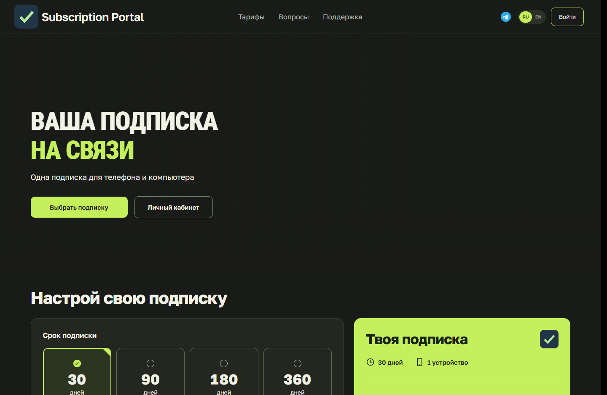

# Subscription Portal

Лендинг с подбором тарифа, личный кабинет и админка для SoloBot API v2. Нужен установленный совместимый бот со своей лицензией, PostgreSQL и Redis.



[Вся страница на компьютере](docs/images/landing-desktop-full.png) · [Первый экран на телефоне](docs/images/landing-mobile.png) · [Вся мобильная страница](docs/images/landing-mobile-full.png). Снимки сделаны в Chrome из сборки с настройками по умолчанию, без подключения к боевому API.

## 1. Подготовьте домены и доступ

Ниже команды для Bash на чистом сервере сайта с Ubuntu 24.04 LTS и отдельном сервере бота с systemd. В примерах замените `portal.example.com` и `bot.example.com` своими именами. Команды для одного сервера выполняйте в одной SSH-сессии. На сайт нужен SSH-доступ с sudo, на бот — доступ к каталогу модулей и управлению его службой.

В DNS создайте A-запись домена сайта на публичный IPv4 сервера сайта. Если публикуете AAAA, проверьте доступность сервера по IPv6. Откройте входящие TCP 80 и 443 в сетевом экране хостера. API бота должен уже отвечать по HTTPS с действительным сертификатом. Проверка с сервера сайта:

```bash
getent ahosts portal.example.com
getent ahosts bot.example.com
curl -sS -o /dev/null -w '%{http_code}\n' https://bot.example.com/api/auth/me
sudo ss -ltnp '( sport = :80 or sport = :443 )'
```

Ожидаемый ответ API без сессии — 401. При IP-фильтре на стороне бота разрешите исходящий адрес сервера сайта в существующей конфигурации API. Доверие к переданному IP клиента ограничьте адресом этого прокси. Если 80/443 уже заняты панелью или другим веб-сервером, используйте вариант в разделе 5.

## 2. Установите Docker и получите проект

На сервере сайта с Ubuntu 24.04 выполните команды ниже. Если `sudo docker compose version` уже работает, достаточно установить Git и перейти к клонированию.

```bash
sudo apt-get update
sudo apt-get install -y ca-certificates curl git nano
sudo install -m 0755 -d /etc/apt/keyrings
sudo curl -fsSL https://download.docker.com/linux/ubuntu/gpg -o /etc/apt/keyrings/docker.asc
sudo chmod a+r /etc/apt/keyrings/docker.asc
sudo tee /etc/apt/sources.list.d/docker.sources >/dev/null <<EOF
Types: deb
URIs: https://download.docker.com/linux/ubuntu
Suites: $(. /etc/os-release && echo "$VERSION_CODENAME")
Components: stable
Architectures: $(dpkg --print-architecture)
Signed-By: /etc/apt/keyrings/docker.asc
EOF
sudo apt-get update
sudo apt-get install -y docker-ce docker-ce-cli containerd.io docker-buildx-plugin docker-compose-plugin
sudo systemctl enable --now docker
sudo docker compose version

mkdir -p "$HOME/sites"
cd "$HOME/sites"
git clone https://github.com/kafka7005/subscription-portal.git
cd subscription-portal
cp .env.example .env
chmod 600 .env
nano .env
```

[Инструкция Docker для Ubuntu](https://docs.docker.com/engine/install/ubuntu/)

## 3. Настройте .env

Пример для своего домена. Замените адреса и имя Telegram-бота. В nano сохраните изменения через Ctrl+O, Enter и выйдите через Ctrl+X.

```dotenv
SITE_DOMAIN=portal.example.com
BOT_API_HOST=bot.example.com
VITE_BRAND_NAME="Мой VPN"
VITE_SUPPORT_URL=https://t.me/your_support_bot
VITE_BOT_URL=https://t.me/your_bot
VITE_TARIFF_GROUP=basic
VITE_VAPID_PUBLIC_KEY=
VITE_YANDEX_ENABLED=false
VITE_OFFER_URL=/docs/offer
VITE_RULES_URL=/docs/rules
VITE_PRIVACY_URL=/docs/privacy
API_PROXY_TARGET=http://127.0.0.1:3004
```

- `SITE_DOMAIN` и `BOT_API_HOST` принимают имена хостов без схемы, порта и пути. Первый задаёт адрес сайта и сертификата, второй — адрес upstream API.
- `VITE_BRAND_NAME` допускает до 48 букв, цифр, пробелов и символов `._-`. Название подставляется и в PWA. Замените `public/icons/logo.svg`, `icon-192.png`, `icon-512.png` и `apple-touch-icon.png` в этом же каталоге. Размер последнего — 180×180.
- `VITE_TARIFF_GROUP` должен совпадать с кодом группы опубликованных платных тарифов бота. Для поддержки внутри кабинета можно оставить `/cabinet/support`.
- Для push скопируйте **публичную** часть VAPID-пары, настроенной в боте. Переменные `VITE_*` попадают в браузер. Токен бота, приватный VAPID-ключ и ключи кассы хранятся на стороне бота.
- `API_PROXY_TARGET` используется сервером разработки. В production адрес берётся из `BOT_API_HOST`. Кнопку Яндекса включайте после настройки провайдера в боте.

## 4. Установите модуль на сервере бота

На сервере сайта узнайте ревизию, которую собираетесь установить:

```bash
cd "$HOME/sites/subscription-portal"
git rev-parse HEAD
```

Теперь **на сервере бота** клонируйте ту же ревизию. Укажите свой каталог бота и имя службы. Для Docker-установки бота модуль должен попасть в постоянный том или образ бота, а перезапуск выполняется его Compose-проектом.

```bash
BOT_DIR=/root/bot
BOT_UNIT=bot.service
if [ -d "$HOME/portal-module-src/.git" ]; then
  git -C "$HOME/portal-module-src" fetch origin main
else
  git clone https://github.com/kafka7005/subscription-portal.git "$HOME/portal-module-src"
fi
cd "$HOME/portal-module-src"
read -rp 'Вставьте SHA с сервера сайта: ' REV
git checkout --detach "$REV"
sudo test -d "$BOT_DIR/modules" && sudo systemctl status "$BOT_UNIT" --no-pager
```

Продолжайте после проверки пути и службы. При обновлении сохраните прежнюю версию за пределами каталога модулей, чтобы бот не загрузил её второй раз.

```bash
(
  set -eu
  target="$BOT_DIR/modules/portal_custom_api"
  if sudo test -d "$target"; then
    backup="/var/backups/portal-module/$(date +%Y%m%d-%H%M%S)"
    sudo mkdir -p "$backup"
    sudo cp -a "$target" "$backup/"
    echo "Копия модуля: $backup/portal_custom_api"
  fi
  sudo cp -R bot-module/portal_custom_api "$BOT_DIR/modules/"
  sudo systemctl restart "$BOT_UNIT"
  sudo systemctl is-active "$BOT_UNIT"
)
sudo journalctl -u "$BOT_UNIT" -n 60 --no-pager
```

На экземплярах со старой частной версией модуля требуется отдельная миграция. Оба варианта регистрируют маршруты `/api/app`; устанавливайте только один. Публичный модуль использует дополнительные маршруты `/api/portal`. Имя desktop-клиента для PKCE — `portal-desktop`. Если нужно изменить подпись приложения, задайте `APP_BRAND_NAME` и `APP_CLIENT_NAME` в окружении службы бота через `sudo systemctl edit "$BOT_UNIT"` в секции `[Service]` директивами `Environment="APP_BRAND_NAME=Мой VPN"` и `Environment="APP_CLIENT_NAME=Мой VPN Desktop"`, затем выполните `sudo systemctl restart "$BOT_UNIT"`.

## 5. Соберите и запустите сайт

Вернитесь **на сервер сайта**. Сборка запускается в Node-контейнере с UID текущего пользователя. Docker Compose подставляет переменные из .env сам.

```bash
cd "$HOME/sites/subscription-portal"
sudo docker run --rm --user "$(id -u):$(id -g)" -e HOME=/tmp \
  -v "$PWD:/app" -w /app node:24-bookworm-slim \
  sh -ec 'npm ci && npm test && npm run build'
test -s dist/index.html
sudo docker compose config --quiet
sudo docker compose run --rm --no-deps site caddy validate --config /etc/caddy/Caddyfile --adapter caddyfile
sudo docker compose up -d
sudo docker compose ps
sudo docker compose logs --tail=60 site
```

При открытых портах и верном DNS Caddy сам выпускает и продлевает сертификат. Его данные хранятся в томе `caddy_data`. [Как работает автоматический HTTPS](https://caddyserver.com/docs/automatic-https)

**Если на машине уже работает Caddy.** После сборки пропустите запуск второго Compose. Скопируйте `dist/` в отдельный каталог, доступный существующему Caddy, например `sudo install -d /srv/subscription-portal && sudo cp -a dist/. /srv/subscription-portal/`. Добавьте в действующий Caddyfile блок из репозитория, подставьте фактические домены и измените `root * /srv` на `root * /srv/subscription-portal`. Для Caddy в Docker каталог статики должен быть примонтирован в его контейнер. Для системного Caddy примените:

```bash
sudo caddy validate --config /etc/caddy/Caddyfile --adapter caddyfile &&
sudo systemctl reload caddy
```

## 6. Проверьте установку и авторизацию

На сервере сайта задайте реальный домен и выполните:

```bash
BASE=https://portal.example.com
curl -fsS -o /dev/null -w 'Главная %{http_code}\n' "$BASE/"
curl -fsS "$BASE/api/app/clients"
curl -sS -o /dev/null -w 'Профиль %{http_code}\n' "$BASE/api/auth/me"
curl -sS -o /dev/null -w 'Журнал %{http_code}\n' "$BASE/api/portal/admin-audit"
curl -fsS "$BASE/manifest.webmanifest"
```

Главная должна вернуть 200, список клиентов — JSON с `portal-desktop`, манифест — ваше название. Профиль и журнал без сессии должны вернуть 401 или 403.

В настройках Telegram Web Login вашего бота разрешите адрес возврата `https://portal.example.com/auth/telegram`. Параметры провайдера настройте на стороне SoloBot. Для кнопки Mini App используйте тип `web_app` и URL `https://portal.example.com/cabinet`. Проверьте оба сценария отдельно. Для входа в `/admin` используйте аккаунт с административными правами в самом боте.

В админке откройте **Сайт** и заполните FAQ, правовые документы и ссылки на приложения. Откройте кабинет обычного клиента, проверьте тарифы и обращение в поддержку. Платёжный сценарий проверяйте на тестовой кассе.

## 7. Изменения, обновления и откат

### Обновить установленный сайт

Для обновлений одной кнопкой подключите [службу обновлений админки](ops/site-updater/README.md).

На сервере сайта откройте каталог установки. Один раз получите сам скрипт, если ставили портал до его появления:

```bash
cd "$HOME/sites/subscription-portal"
git pull --ff-only
sudo apt-get install -y rsync
```

Дальше для обычной установки из раздела 5 достаточно одной команды:

```bash
bash scripts/update.sh
```

Скрипт получает изменения отслеживаемой Git-ветки, собирает портал с вашей `.env` и иконками, запускает тесты и публикует готовую статику. При конфликте Git останавливает обновление. При неудачной сборке действующая версия продолжает работать. После изменения только `VITE_*` запустите ту же команду. При изменении доменов или настроек Compose дополнительно выполните `sudo docker compose up -d --force-recreate`.

```bash
bash scripts/update.sh --check       # сколько новых коммитов доступно
bash scripts/update.sh --rollback    # вернуть предыдущую опубликованную сборку
```

Для внешнего Caddy укажите **тот каталог, из которого он уже раздаёт портал**. Пользователю установки нужна запись в этот каталог и его подкаталоги.

```bash
bash scripts/update.sh --web-root /srv/subscription-portal
bash scripts/update.sh --rollback --web-root /srv/subscription-portal
```

Копии статики хранятся в `.portal-update/backup.*` рядом с исходниками. Путь к созданной копии выводится после обновления. `previous` указывает на копию для быстрого отката. Старые копии можно удалять вручную, сохраняя цель `previous`. Старые ресурсы остаются доступны открытым вкладкам. Откат возвращает статику, Git остаётся на новой ревизии. Модуль на отдельном сервере бота обновляется по разделу 4. Перед его обновлением сравните установленные ревизии: при первоначальном `git pull` изменения модуля могли уже попасть в рабочую копию.

**Если скачивали ZIP**, сохраните исходный каталог сайта. Клонируйте проект рядом по разделу 2, перенесите свою `.env` и изменённые иконки в новый клон, затем укажите работающий каталог статики:

```bash
cd "$HOME/sites"
git clone https://github.com/kafka7005/subscription-portal.git portal-updates
cd portal-updates
read -rp 'Полный путь к прежней установке: ' old
install -m 600 "$old/.env" .env
cp -a "$old/public/icons/." public/icons/
bash scripts/update.sh --web-root "$old/dist"
```

Для следующих обновлений используйте этот же клон и тот же `--web-root`. Если в прежней установке меняли исходный код, перенесите свои изменения перед первой сборкой.

Если обновлялся модуль, выполните на сервере бота (укажите свои BOT_DIR и BOT_UNIT из раздела 4):

```bash
read -rp 'Полный путь к сохранённому каталогу portal_custom_api: ' saved_module
(
  set -eu
  : "${BOT_DIR:?Укажите каталог бота}" "${BOT_UNIT:?Укажите службу бота}"
  sudo test -s "$saved_module/api.py"
  staged=$(sudo mktemp -d "$BOT_DIR/.portal-restore.XXXXXX")
  sudo cp -a "$saved_module" "$staged/portal_custom_api"
  sudo mv "$BOT_DIR/modules/portal_custom_api" "$staged/previous"
  sudo mv "$staged/portal_custom_api" "$BOT_DIR/modules/portal_custom_api"
  sudo systemctl restart "$BOT_UNIT"
  sudo systemctl is-active "$BOT_UNIT"
)
```

 Состояние PostgreSQL и Redis обслуживается средствами бота.

## 8. Диагностика

| Симптом | Что проверить |
|---|---|
| Не выпускается сертификат | DNS A/AAAA, входящие TCP 80/443, `sudo docker compose logs --tail=100 site` |
| Главная открывается, API отвечает 502 | С сервера сайта вызовите `curl -v https://bot.example.com/api/auth/me`. Проверьте DNS, сертификат upstream и сетевой доступ |
| Вместо списка приложений HTML или 404 | Адрес `BOT_API_HOST`, маршрут `/api/*` в прокси, загрузку модуля по `journalctl` |
| Вход успешен, тарифов нет | Группу `VITE_TARIFF_GROUP`, опубликованные тарифы и пересборку после правки .env |
| После изменения .env осталось старое имя | Пересоберите фронтенд. Проверьте название в `curl -fsS "$BASE/manifest.webmanifest"` |
| На сервере уже занят порт | `sudo ss -ltnp '( sport = :80 or sport = :443 )'`. Используйте существующий прокси по разделу 5 |

## Локальная разработка

При установленном Node.js 22.12+ и npm:

```bash
git clone https://github.com/kafka7005/subscription-portal.git
cd subscription-portal
cp .env.example .env
npm ci
npm test
npm run dev
```

По умолчанию Vite слушает loopback. Адрес разработки появится в терминале. Если API доступен только на loopback удалённой машины, откройте в другом терминале `ssh -N -L 3004:127.0.0.1:3004 user@bot-host`, подставив свой SSH-адрес и фактический порт API. Для контрольной сборки выполните `npm run build && npm run preview`.

## Использование и проверка

Вы можете установить эту версию сайта, изменить её под свой сервис и использовать с собственной лицензированной установкой бота. Для сторонних библиотек, шрифтов и флагов действуют их исходные лицензии.

Тесты интерфейсной логики запускаются командой `npm test`. Для тестов модуля в отдельном Python-окружении установите FastAPI, Pydantic 2 и `SQLAlchemy[asyncio]`. Запускайте каждый файл `bot-module/portal_custom_api/test_*.py` отдельным процессом. Тесты используют подмены сервисов оплаты и хранения.

Для обновления проверяйте `npm audit` и отдельно `npm audit --omit=dev`. Сервер разработки предназначен для локального использования. В production раздавайте собранный каталог `dist`. Клиентские проверки дополняют серверные разрешения. Для приёмки используйте собственный тестовый экземпляр бота с отдельными аккаунтами клиента, сотрудника и администратора.
